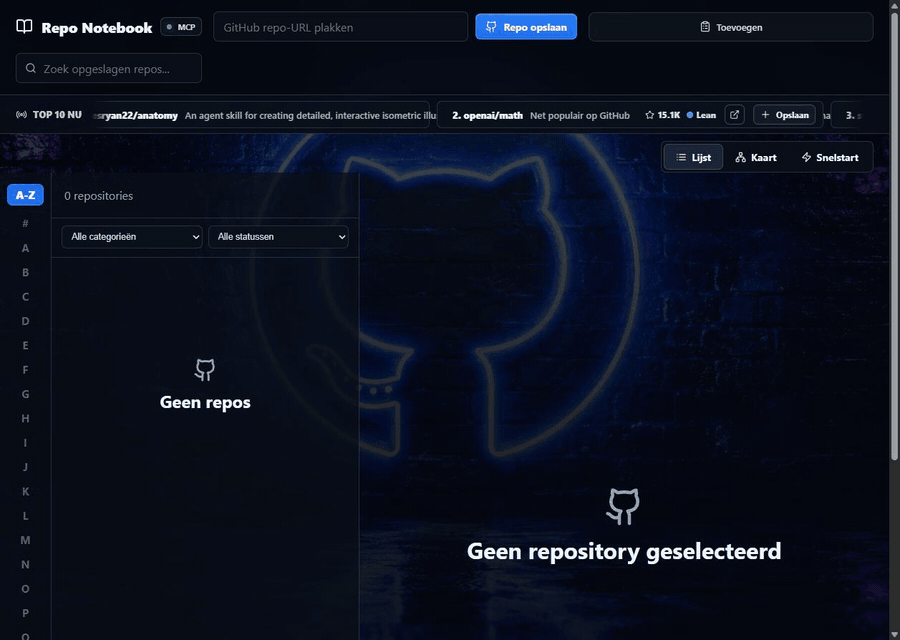
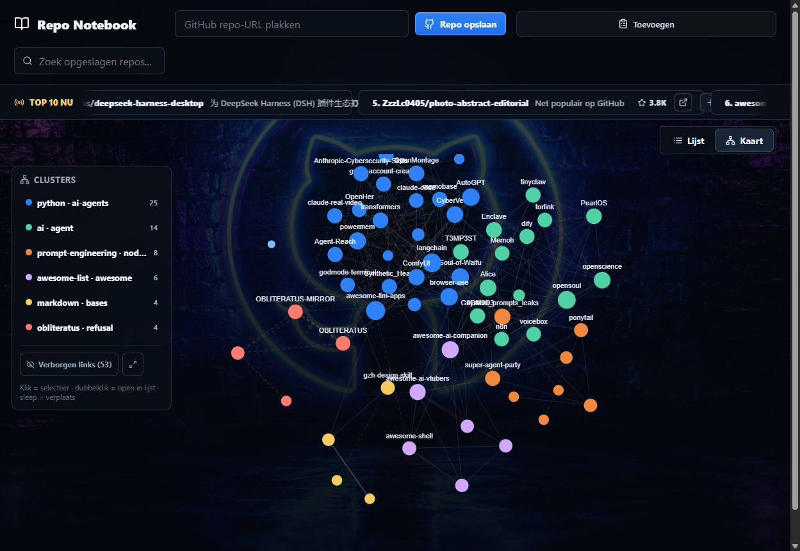
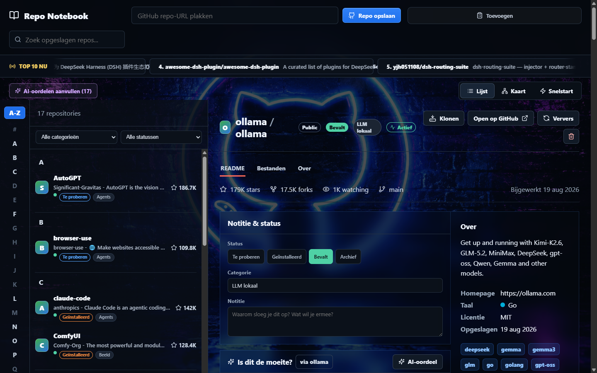

# Repo Notebook

🌐 **Website:** [thomashuybrechts.com/repo-notebook](https://thomashuybrechts.com/repo-notebook/) · 👤 Built by [Thomas Huybrechts](https://thomashuybrechts.com/)

Repo Notebook is a local desktop app (and plain Node app) for the GitHub repositories you want to *try*, not just star. Paste a URL and it saves the repo with metadata and README; one click more and it clones, detects how the project runs, installs it and starts it — with live logs, in one window. Everything stays on your machine in a single JSON file.

The interface is available in **English and Dutch**. Use **EN / NL** in the header
to switch immediately; the app remembers your choice on this device. English is
the default. Navigation, dialogs, tooltips, app errors, and dates follow your
language. Your own notes, README content, repository details, and terminal output
stay as written. New AI verdicts use the selected language; saved verdicts remain
as generated until you refresh them.



*Paste a URL, clone, and install with live logs: about 25 seconds, no terminal.*



## Features

**The shelf**
- Paste a GitHub URL (or `owner/repo`) → metadata, topics, license, stars and the README are stored locally, sorted A–Z like an old-school address book.
- Bulk add: paste any text (a post, a newsletter) and every `github.com/owner/repo` in it is saved. Import your GitHub stars. Export/import the whole notebook as JSON.
- Live **Top 10 now** ticker with trending repos — one click saves one to the shelf.
- Per repo: category, status (*try / installed / keep / archive*), your own note, a health badge (active / quiet / stale / archived from the last push), duplicate detection against your other clone folders, and search that also looks inside READMEs.



- **Knowledge-graph map**: the app links your repos by shared topics, README/description similarity (TF-IDF), same author/category/language, and explains every link. Label propagation groups them into named clusters; links that only the text reveals are shown as *hidden links*. Click a node for the "why", double-click to open it in the list. A "Related repos" panel shows the same for the selected repo.
- **Personal suggestions on the map**: a toggle adds GitHub repos you *don't* have yet as dashed ghost nodes, hanging off the clusters they match. Candidates come from GitHub search queries derived from your shelf's taste (statuses weigh in: *keep* counts hardest, *archive* barely) and are scored by the same explainable engine — every ghost shows which of your repos it matches and why, with a one-click **save**. No AI calls, no tokens: pure TF-IDF and topics.

**Run it**
- Clone into the app's own folder, then the app detects the stack — Node, Python, Rust, Go, Docker Compose, Make — and offers install / start / stop with live logs. It sniffs the dev-server URL from the output and offers **Open in browser**.
- Python installs always go into a `.venv` inside the clone — never your global site-packages.
- **Quick start tab**: every clone as a card with start/stop, PID and uptime, URL, "open folder" and "jump to list"; a port guard warns when two running repos want the same port; "check all updates" fetches every clone and shows how many commits behind each one is (pull from the app).
- `.env` editor per clone (with `.env.example` as template), git pull, disk size per clone, delete clone.
- **Terminal** per cloned repo: a drawer with a persistent shell (PowerShell on Windows, your `$SHELL` elsewhere) that starts in the clone folder — `git status`, an npm script, a quick look around — without leaving the app.
- Optional **container mode** (opt-in per repo): install and run inside Docker (node / python / golang / rust base images, or the repo's own compose file), clone bind-mounted, ports mapped, optional GPU; Docker Desktop is started on demand.

**AI, agents, Obsidian**
- **"Is this worth it?"** verdict per repo — local **Ollama** by default (zero tokens), Anthropic or OpenAI optional. Bulk verdicts for everything you saved (only with a local provider unless you force it).
- **MCP server**: `list_saved_repos`, `search_saved_repos`, `save_repo`, `bulk_save`, `search_github`, `clone_repo`, `trending_repos`, `set_repo_meta`, `remove_repo` — Claude Code, Codex or any MCP client drives the same shelf. Two transports: **stdio**: run `npm link` once in the clone and register `repo-notebook-mcp` (no arguments) as a stdio server in your AI agent — Claude Code: `claude mcp add repo-notebook -- repo-notebook-mcp`; Codex: `[mcp_servers.repo-notebook]` with `command = "repo-notebook-mcp"` in `~/.codex/config.toml`; Cursor, Claude Desktop and other JSON-configured clients: `"repo-notebook": { "command": "repo-notebook-mcp" }` under `mcpServers`. Without `npm link`, use `node mcp/server.js` as the command instead. **Streamable HTTP**: `http://127.0.0.1:<port>/mcp` while the app runs, for clients that support HTTP servers (Claude Code example: `claude mcp add --transport http repo-notebook http://127.0.0.1:5188/mcp`). The **MCP** chip in the app shows the live endpoint and copy-ready commands; the endpoint stays behind the loopback guard.
- **Obsidian plugin** (`obsidian-plugin/`): every saved repo becomes a note, the graph links become `[[wikilinks]]` (your repo map in Obsidian's graph view), a side panel with clone/install/start/stop, and two-way status/category/notes sync through the same data file. The plugin follows Obsidian's language (English or Dutch), with a manual override in its settings. See [obsidian-plugin/README.md](obsidian-plugin/README.md).

## Run

```bash
npm install
npm run dev          # dev server + Vite, http://127.0.0.1:5188
```

Desktop app (Electron, same server in its own window) — **Windows, macOS and Linux**:

```bash
npm run app              # start
npm run app:build        # installer for the OS you are on (electron-builder, output in release/)
npm run app:build:win    # NSIS installer (.exe)
npm run app:build:mac    # .dmg + .zip, arm64 and x64 (build on a Mac)
npm run app:build:linux  # AppImage + tar.gz, x64 and arm64
```

Ready-made builds for all three come from the [GitHub Actions workflow](.github/workflows/build.yml): every push builds them as artifacts, a `v*` tag attaches them to a draft release. They are unsigned: Windows shows SmartScreen's *More info → Run anyway*, macOS needs *right-click → Open* the first time (or `xattr -dr com.apple.quarantine "Repo Notebook.app"`), Linux AppImages need `chmod +x`.

From a clone you can also double-click `Start Repo Notebook.bat` (Windows) or `Start Repo Notebook.command` (macOS), or run `scripts/start-repo-notebook.sh` (Linux/macOS). The app needs `git` on your PATH; `python` (`python3` on Linux/macOS) for Python repos; Docker only for container mode (Docker Desktop on Windows/macOS, Docker Desktop's user service or your own daemon on Linux). On macOS/Linux the packaged app reads your login shell's PATH once at start, so tools from Homebrew, nvm, `~/.local/bin` or `~/.cargo/bin` are found like in a terminal.

Data lives in one per-user folder — Windows `%LOCALAPPDATA%\RepoNotebook\data`, macOS `~/Library/Application Support/RepoNotebook/data`, Linux `~/.local/share/RepoNotebook/data` (`$XDG_DATA_HOME`) — or wherever `RN_DATA_DIR` points: `notebook.json`, `clones/`, `runs/`, `server.log`, `remote.json`. The server writes `server.json` (port, pid, MCP endpoint, remote port) next to it on start so clients such as the Obsidian plugin can find the desktop app, which uses port 5188 when free and any free port otherwise. Opening `/#repo=owner/name` selects that repo in the UI.

## On your phone or tablet (iPhone, iPad, Android)

Cloning and running needs a real computer, so the phone version is a **remote**: the app keeps running on your PC or Mac and your phone drives it. Click the **Phone** chip in the header, switch remote mode on and scan the QR code with your camera — the page opens with the same shelf, map, Quick start, logs and terminal, laid out for a small screen. In Safari choose *Share → Add to Home Screen* (Chrome on Android: *Install app*) and it behaves like an app that pairs itself on first open.

How it works: remote mode opens a second listener on all interfaces (port 5189 by default, `RN_REMOTE_PORT`/`RN_REMOTE_BIND` to change) that demands an **access code** on every request — set once as a cookie by the QR link, or sent as `Authorization: Bearer …` by scripts — plus the same-origin check for writes. The code grants full control (clone, install, run), so scan it on your own devices only; *New access code* unpairs everything. Over [Tailscale](https://tailscale.com) it works from anywhere without opening a port on your router. The QR code and the code itself are only ever shown on the computer, never to a remote client. `RN_REMOTE=1` forces remote mode on at start (headless setups).

## Security & privacy

Repo Notebook runs entirely on your own machine and binds to `127.0.0.1` only (remote mode, above, is opt-in and token-protected). Because it can **clone, install and run** the repositories you save, it executes third-party code that you choose — treat it like running any repo locally. The local server rejects requests from other origins/hosts (CSRF + DNS-rebinding guard; only its own origin and the Obsidian plugin's `app://obsidian.md` are allowed), so a website you visit cannot drive it. Your saved repos, clones and any tokens stay local (see `.gitignore`); nothing is uploaded.

Optional environment variables:

- `GITHUB_TOKEN` — higher GitHub API rate limit and access to private repos.
- `RN_DATA_DIR` — data folder (default per platform, see above). `PORT` — server port (default 5188; the desktop app picks a free one).
- `RN_REMOTE` (`1`), `RN_REMOTE_PORT` (default 5189), `RN_REMOTE_BIND` (default `0.0.0.0`) — remote mode for phones/tablets; normally toggled from the **Phone** chip, stored in `remote.json`.
- `RN_SKIP_SHELL_PATH` (`1`) — macOS/Linux: don't ask the login shell for its PATH at start.
- `RN_AI_PROVIDER` — `ollama` (default, local, no tokens) · `anthropic` · `openai`. `RN_AI_MODEL` — model name. `RN_OLLAMA_URL` / `OLLAMA_HOST` — where Ollama listens. `ANTHROPIC_API_KEY` / `OPENAI_API_KEY` / `OPENAI_BASE_URL` — only for those providers.
- `RN_TERMINAL_SHELL` — shell for the embedded terminal (default `powershell.exe` on Windows, `$SHELL` elsewhere; bash/zsh start without rc files).
- `RN_EXTRA_CLONE_DIRS` — extra folders (`;`-separated) scanned for duplicate clones (default: none; a missing folder is skipped).

## Notes

This app is intended for public repositories. Private repositories may require GitHub credentials for both API access and cloning. More background: [docs/product/repo-notebook.md](docs/product/repo-notebook.md) and [docs/architecture/local-app.md](docs/architecture/local-app.md).

MIT © Thomas Huybrechts
